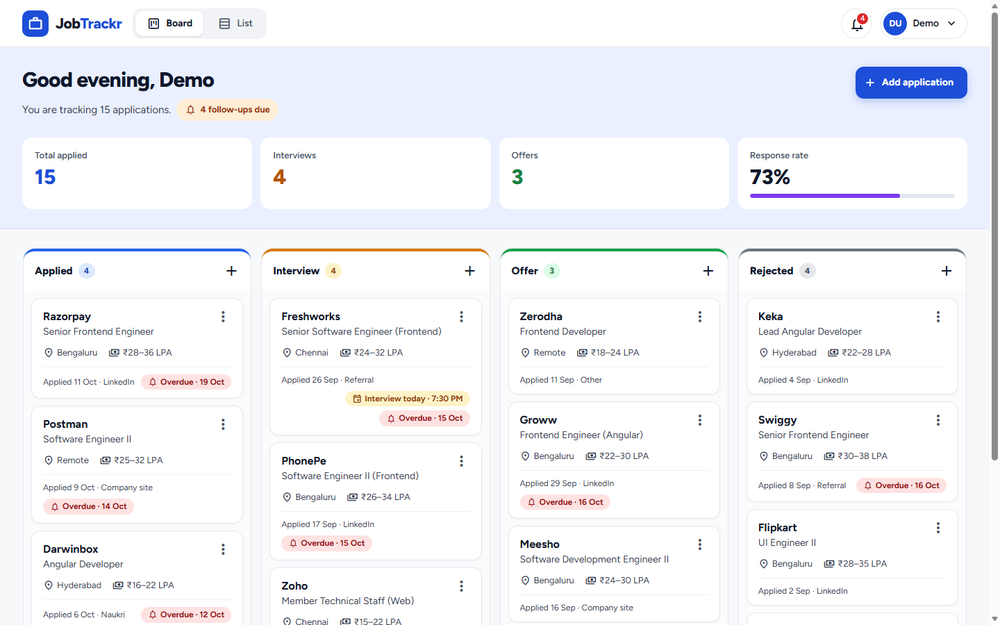
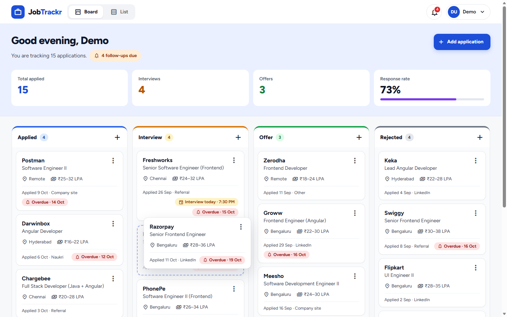
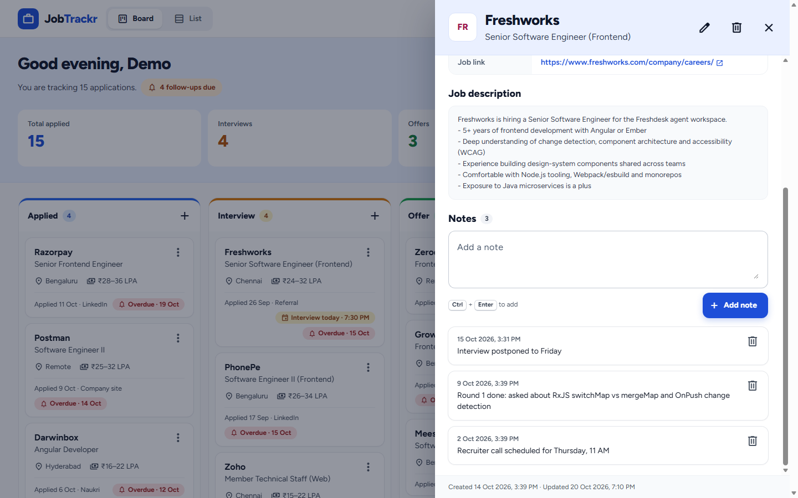
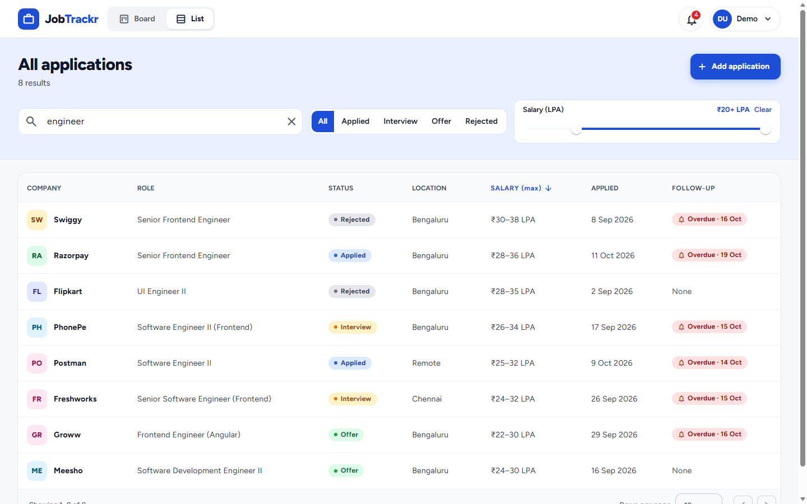
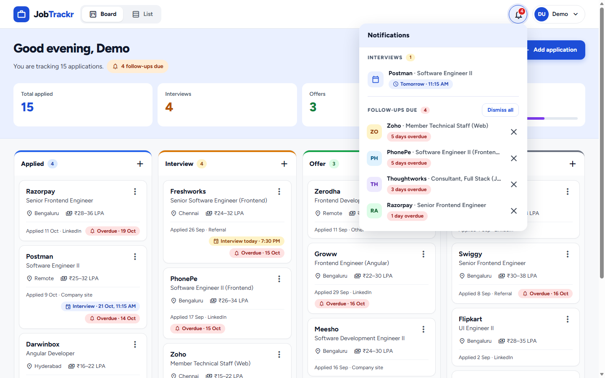
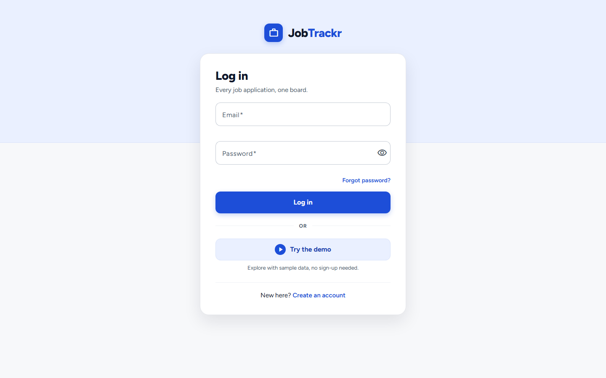
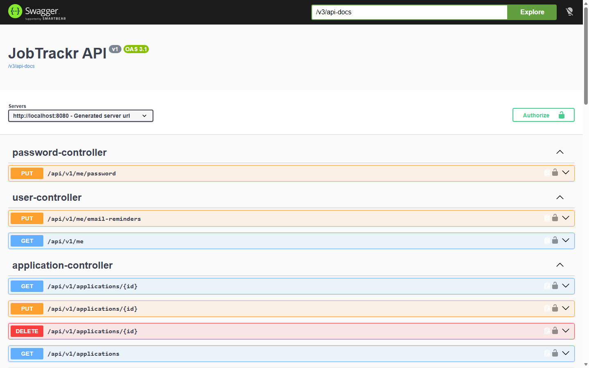
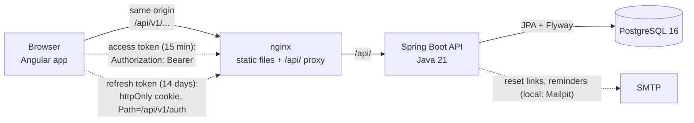

# JobTrackr

[](https://github.com/varsha-k-karthikeyan/jobtrackr/actions/workflows/ci.yml)

**A job application tracker with a drag-and-drop Kanban board, follow-up reminders and a searchable list, built with Angular 22, Spring Boot 4 and PostgreSQL.**

**Live demo:** none; the app is not hosted, by choice. It runs locally with Docker in two commands (see [Quick start](#quick-start)).

## Screenshots

All taken from the public demo account (sample data only). How they were captured, and the script for a short tour GIF, are in [docs/screenshots](docs/screenshots/README.md).









<!-- Uncomment once docs/screenshots/demo.gif exists (script in docs/screenshots/README.md):

-->

## Features

- **Kanban board** with four columns (Applied, Interview, Offer, Rejected). Drag and drop is optimistic (the card moves at once and rolls back if the server refuses), and positions stay gap-free on the server.
- **Details drawer** with notes, an edit dialog that detects concurrent edits (409) and reloads the latest version, and delete with confirmation.
- **Searchable list**: server-side paging and sorting, free-text search over company, role, location, source and status, a status filter and a two-thumb salary range slider; the whole view lives in the URL, so reload and back/forward work.
- **Interviews**: give a card an interview date and time (type it or pick a 30-minute step, plus AM/PM); it shows on the card ("Interview today · 2:30 PM") and in the details drawer.
- **Notification bell**: lists upcoming interviews with their times and follow-ups that are due, overdue or coming up in the next 7 days; the badge counts due follow-ups and today's interviews; dismiss follow-ups one by one or all at once (an interview drops off once it starts); clicking opens the card.
- **Reminder emails**: an 8:00 AM digest of due follow-ups and the day's interviews with their times, and an email 30 minutes before each interview (also when the time is set or changed less than 30 minutes ahead). One on/off switch in the account menu; off takes effect from the next minute.
- **Stats strip**: totals per column and the response rate.
- **Accounts**: register, log in, change password, and "forgot password" by email (locally caught by Mailpit). Sessions survive reloads and stay alive while you use the app.
- **Try the demo**: a public demo account with 16 sample applications, one click from the login page.

## Tech stack

| Area | Technology |
|---|---|
| Frontend | Angular 22 (standalone components, Signals, zoneless, OnPush), Angular Material 22 + CDK drag and drop, Tailwind CSS 4, Vitest |
| Backend | Spring Boot 4.1, Java 21, Spring Web MVC, Spring Data JPA (Hibernate), Bean Validation, Spring Security OAuth2 resource server (JWT, HS256), Flyway, Actuator, springdoc-openapi (Swagger UI) |
| Database | PostgreSQL 16 |
| Tests | JUnit 5, Mockito, AssertJ, MockMvc, Testcontainers, JaCoCo; Vitest with Angular's unit-test builder |
| Delivery | Docker (multi-stage images, nginx), Docker Compose, GitHub Actions |
| Repository | Monorepo; Conventional Commits enforced by commitlint and husky |

## Architecture



- The browser holds a **short-lived JWT access token** and sends it as `Authorization: Bearer`. The long-lived **refresh token** lives only in an **httpOnly, SameSite=Strict cookie** that JavaScript cannot read.
- nginx serves the Angular build and forwards `/api/` to the backend, so the browser sees **one origin**: the cookie is first-party and CORS is not needed in production.
- Code structure, data model and the main algorithms: [docs/ARCHITECTURE.md](docs/ARCHITECTURE.md).

## Quick start

Needs only [Docker Desktop](https://www.docker.com/products/docker-desktop/).

```powershell
Copy-Item .env.example .env                  # once; then set your own random JWT_SECRET in .env
docker compose --profile full up --build     # PostgreSQL, Mailpit, the API and the app
```

Then open **http://localhost:4200** and click **Try the demo**.

Also running: Swagger UI at http://localhost:8080/swagger-ui.html, the Mailpit inbox (password-reset and reminder emails) at http://localhost:8025. Stop with `Ctrl+C`, or `docker compose --profile full down` (keeps the data).

## Developer setup

Prerequisites: JDK 21, Docker Desktop, Node.js 22.22.3+ or 24.15+ (Angular 22's requirement). Windows PowerShell; quote the path because it contains a space.

```powershell
# 1. Database and Mailpit only (the backend and frontend run on your machine)
cd "E:\JobTrackr project"
docker compose up -d

# 2. Commit hook, once per clone
npm install

# 3. Backend on http://localhost:8080 (needs JWT_SECRET, see below)
cd "E:\JobTrackr project\jobtrackr-backend"
.\mvnw.cmd spring-boot:run        # or run JobtrackrBackendApplication in IntelliJ

# 4. Frontend on http://localhost:4200, in a second terminal
cd "E:\JobTrackr project\jobtrackr-frontend"
npm install                        # first time only
npm start
```

### The JWT secret

The backend needs `JWT_SECRET`, any random string of at least 32 characters, to sign login tokens. For local development, put it in `jobtrackr-backend/.env.properties`, which Spring reads at startup and git ignores. It works the same from IntelliJ, Maven or a terminal. Create it once:

```powershell
cd "E:\JobTrackr project\jobtrackr-backend"
$bytes = New-Object byte[] 48; [Security.Cryptography.RandomNumberGenerator]::Create().GetBytes($bytes)
"JWT_SECRET=$([Convert]::ToBase64String($bytes))" | Out-File -Encoding ascii .env.properties
```

A real `JWT_SECRET` environment variable, if set, takes priority over the file; that is how a deployed server would provide it. Keep the value stable: changing it logs out everyone who holds a token.

Every variable the backend reads is listed, with placeholders, in [`.env.example`](.env.example). Only `JWT_SECRET` is required; the others (`CORS_ALLOWED_ORIGINS`, `REFRESH_COOKIE_SECURE`, `NOTIFICATIONS_ZONE`, `SCHEDULING_ENABLED`, `TOKEN_CLEANUP_CRON`, `REMINDER_EMAILS_CRON`, `APP_URL`, `MAIL_FROM`, the `MAIL_*` server settings and the Docker settings) have working defaults. Real values never go in that file: `.env` and `.env.properties` are git-ignored, `.env.example` is not.

#### Environment variables in an IntelliJ run configuration (Windows)

Use this instead of the file, or to override it:

1. **Run > Edit Configurations...** and select `JobtrackrBackendApplication`. If it is missing, click **+**, choose **Spring Boot** (or **Application** in the Community edition), set the main class to `com.jobtrackr.jobtrackrbackend.JobtrackrBackendApplication` and the module to `jobtrackr-backend`.
2. Set **Working directory** to `E:\JobTrackr project\jobtrackr-backend`. The `.env.properties` file is looked up relative to it, so with the monorepo root as the working directory the file is silently skipped and startup fails on the missing `JWT_SECRET`.
3. In **Environment variables** (if the field is hidden: **Modify options > Environment variables**), click the icon at the right end of the field, then **+**, and add `JWT_SECRET` with your value. Typed directly, the format is `JWT_SECRET=...;CORS_ALLOWED_ORIGINS=http://localhost:4200`, with entries separated by semicolons.
   Alternatively, copy `.env.example` to `.env`, fill it in, and select that file with the field's folder icon (recent IntelliJ versions load `.env` files there).
4. Leave **Store as project file** unchecked. Run configurations then live in `.idea/`, which is git-ignored; a stored one would be written to `.run/` and could be committed together with your secret.
5. **Apply**, then run. A missing secret fails at startup with `jobtrackr.jwt.secret` in the error.

### Swagger UI

Open http://localhost:8080/swagger-ui.html, call `POST /api/v1/auth/register` (or `/login`), copy `accessToken` from the response, click **Authorize** and paste it (without the word "Bearer"). Every other endpoint then works.

### Emails (forgot password, reminders)

Locally nothing is really delivered: the backend sends to **Mailpit**, a mail catcher started by `docker compose up -d`, and you read every email at http://localhost:8025. No account is needed. To deliver real email, point the `MAIL_*` variables at a provider; no code changes.

- **Forgot password** emails a reset link. It works once and expires after 30 minutes.
- **Reminder emails** come from a job that checks every minute: the morning digest from 8:00 AM (India time; sent later the same day if the backend was not running at 8), and a reminder once an interview is less than 30 minutes away. Register your own account to receive them: the shared demo account gets none. Switch them off (and on) in the account menu, under your name; off takes effect from the next minute.

## Tests and quality

| | Command | Result (latest run) |
|---|---|---|
| Backend | `.\mvnw.cmd verify` in `jobtrackr-backend` | 151 tests (unit and integration), about 1 minute; JaCoCo line coverage 98.3%, branch coverage 92.9% |
| Frontend | `npm run test:ci` in `jobtrackr-frontend` | 106 tests in 22 files |
| Frontend build | `npx ng build --configuration production` | Initial bundle 344 kB (94 kB transferred), budget 500 kB |
| Docker images | `docker compose --profile full build` | Backend 395 MB (JRE 21), frontend 98 MB (nginx) |

- Integration tests run against a **real PostgreSQL 16 started by Testcontainers** on a random port: Docker Desktop must be running, the compose database is not needed. Tests roll back (or delete) their own data and use their own dummy JWT secret.
- The coverage report is written to `jobtrackr-backend/target/site/jacoco/index.html`.
- **CI** ([`.github/workflows/ci.yml`](.github/workflows/ci.yml)) runs on every push and pull request to `main`: backend `verify`, frontend tests and production build, both Docker images, and commit-message linting on pull requests.

## Design decisions

- **Stateless JWT plus rotating refresh tokens in an httpOnly cookie.** The access token lives 15 minutes; the refresh token is opaque, stored only as a SHA-256 hash, rotated on every use, and kept in an `HttpOnly; SameSite=Strict` cookie scoped to `/api/v1/auth`, so an XSS bug can steal at most a token that expires within minutes. Presenting an already-rotated token again (a sign of theft) revokes every session of that user. On a 401 the frontend makes one shared refresh and retries once.
- **Flyway owns the schema; Hibernate only validates it** (`ddl-auto=validate`). Every change is a new numbered migration, never an edit to an applied one, and a test migrates an empty database from V1 to the latest version on every run.
- **Optimistic locking and gap-free positions.** Each card carries a `version`; saving a stale copy is a 409 and the edit dialog reloads the latest version. Moving a card shifts its neighbours with one bulk `UPDATE` that does not touch their versions, so dragging one card never makes the others stale.
- **Every query is scoped to the current user.** The user id comes only from the verified JWT, never from a URL or body, and another user's record looks exactly like a missing one (404). Integration tests check this for every endpoint.
- **The bell is computed per request**, from the follow-up dates and interview times, in an explicit time zone (`Asia/Kolkata`, not the JVM's UTC), so it can never be out of step with the board.
- **Reminder emails: one job that runs every minute and asks "what is due now?"** instead of a cron at 8:00 plus a timer per interview. It covers an interview saved 15 minutes ahead, a time changed after its reminder went out, and a backend that was down at 8:00. What was sent is stored (for an interview: the time it was sent *for*, so moving the interview re-arms it), and only after a successful send.
- **Testcontainers instead of a shared database** for integration tests: one throwaway PostgreSQL 16 for the whole run, the same version as development and production, on any machine with Docker.
- **One origin in production.** nginx proxies `/api/`, so the refresh cookie stays first-party, CORS is unnecessary and the security model is the same as in development.

## API at a glance

Base path `/api/v1`. Everything except `/auth/**` (and the health check) needs `Authorization: Bearer <token>`. Swagger UI is the full, always-current reference.

| Method and path | Purpose |
|---|---|
| `POST /auth/register`, `POST /auth/login` | Create an account or log in; returns a 15-minute access token and sets the 14-day httpOnly refresh cookie |
| `POST /auth/refresh` | No body: the browser sends the cookie. Rotates the refresh token, returns a new access token |
| `POST /auth/logout` | Revokes the refresh token and deletes the cookie |
| `POST /auth/forgot-password` | Emails a single-use, 30-minute reset link; always 204, so it never reveals whether an address is registered |
| `POST /auth/reset-password` | Sets a new password from the link and ends every session; 400 if the link is used, expired or unknown |
| `GET /me`, `PUT /me/password` | The caller's profile; change password (400 on a wrong current password, 403 for the demo account) |
| `PUT /me/email-reminders` | Switches reminder emails on or off (`{"enabled": false}`); answers with the updated profile. 403 for the demo account |
| `GET /applications/board` | All cards grouped by status, ordered by position |
| `GET /applications?status=&searchText=&salaryFrom=&salaryTo=&sort=&page=&size=` | Filtered, sorted, paginated list; empty values sort last |
| `POST /applications`, `GET`/`PUT`/`DELETE /applications/{id}` | Create (appended to its column), read with notes, update (needs the current `version`), delete |
| `PATCH /applications/{id}/move` | Move a card to a column and position |
| `POST /applications/{id}/notes`, `DELETE /notes/{id}` | Add or delete a note |
| `GET /stats` | Counts per status, total and response rate |
| `GET /notifications`, `DELETE /notifications[/{applicationId}]` | Due and upcoming follow-ups; dismiss one or all |
| `GET /actuator/health` | Public health check: `{"status":"UP"}` and nothing else |

## Demo account

Log in with **demo@jobtrackr.dev** / **Demo@1234** (or click **Try the demo**) to explore 16 sample applications with notes and follow-up dates. The password is published on purpose: the account is for exploring, so its password cannot be changed or reset; register your own account for real use.

The data is created by the Flyway migration `V4__demo_user_data.sql` in your own database, with dates relative to the day it runs. To get the original demo data back (this also deletes accounts you registered locally): `docker compose down -v`, then `docker compose up -d` and start the backend.

## Repository layout

| Path | What it is |
|---|---|
| `jobtrackr-backend/` | REST API: Spring Boot 4.1, Java 21, Maven; `Dockerfile` |
| `jobtrackr-frontend/` | Angular 22 app; `Dockerfile` and `nginx.conf` ([its README](jobtrackr-frontend/README.md)) |
| `docker-compose.yml` | PostgreSQL and Mailpit for development; the whole stack with `--profile full` |
| `.github/workflows/ci.yml` | Continuous integration |
| `docs/` | [Architecture](docs/ARCHITECTURE.md), [debugging guide](docs/DEBUGGING.md), screenshots |
| `CONTRIBUTING.md` | Commit format and recipes for adding a column, an endpoint or a feature |
| `CLAUDE.md` | Working rules for AI coding agents; also a one-page summary for people |
| `commitlint.config.js`, `.husky/`, `package.json` | Commit message linting (repository tooling only) |

## What I'd do next

- **Host it** if it ever needs a public URL. The images, health check and configuration are ready, and the hosting options are compared in [docs/ARCHITECTURE.md](docs/ARCHITECTURE.md#17-deployment).
- **AI resume match**: score a resume against a job description and list matched and missing skills (the reason `jdText` is stored with each application).
- **A "log out everywhere" button**: reuse detection already revokes every session internally; it only needs an endpoint and a menu item.
- **Playwright end-to-end tests** against the Docker stack in CI (log in as demo, move a card, reload).

## How this was built

I used AI coding assistants (Claude Code) while building JobTrackr. I made the design decisions, worked in small stages, reviewed every diff before committing, and ran the tests and checks myself; the decisions above are mine to explain, and I can walk through any part of the code.

## License

[MIT](LICENSE) © 2026 Varsha Karthikeyan
