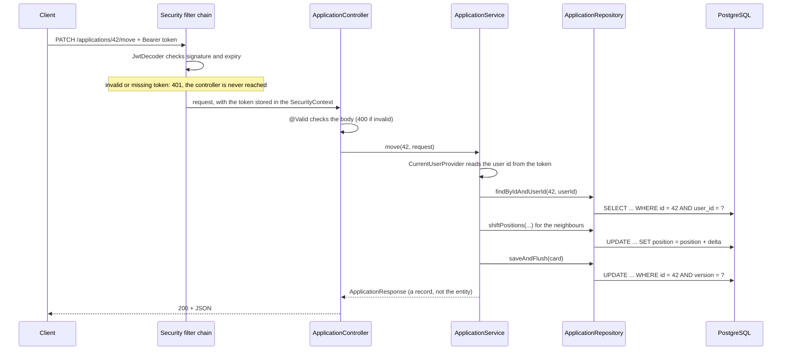
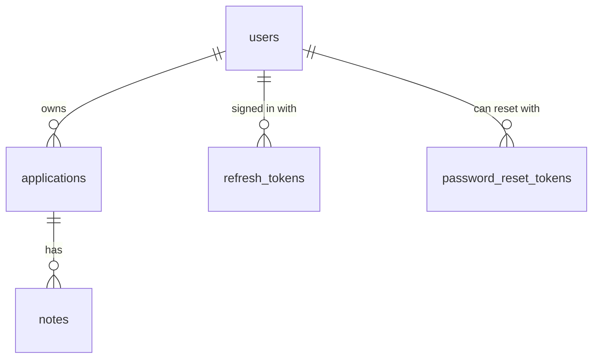
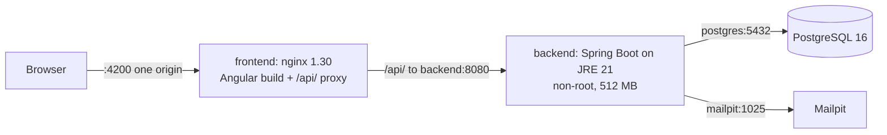

# Architecture

How the JobTrackr backend is organised and how its main logic works. Read this before changing code; read [DEBUGGING.md](DEBUGGING.md) when something is broken.

This document covers the backend. The frontend's structure, data flow and conventions are in [jobtrackr-frontend/README.md](../jobtrackr-frontend/README.md).

All paths below are relative to `jobtrackr-backend/`. The base Java package is `com.jobtrackr.jobtrackrbackend`.

## 1. Layout

```
jobtrackr-backend/
├── pom.xml                                   dependencies and build
└── src/
    ├── main/
    │   ├── java/com/jobtrackr/jobtrackrbackend/
    │   │   ├── JobtrackrBackendApplication   entry point; sets the JVM to UTC
    │   │   ├── application/                  job applications = Kanban cards (the core feature)
    │   │   ├── note/                         notes attached to an application
    │   │   ├── user/                         the account entity and GET /me
    │   │   ├── auth/                         register, login, JWT, security configuration
    │   │   ├── stats/                        counts per status and response rate (GET /stats)
    │   │   ├── notification/                 follow-up reminders for the bell in the header (GET /notifications)
    │   │   └── common/                       shared pieces: current user, errors, paging, OpenAPI, CORS, clock, scheduling
    │   └── resources/
    │       ├── application.yml               all configuration
    │       └── db/migration/                 Flyway SQL migrations (the only place schema changes)
    └── test/
        ├── java/...                          mirrors the main packages
        └── resources/application-test.yml    test-only settings (dummy JWT secret, scheduling off)
```

The code is **packaged by feature, not by layer**. There is no global `controllers` or `services` package. To work on notes, everything you need is in `note/`.

## 2. What is inside a feature package

Every feature follows the same shape. Using `application/` as the example:

| Class | Role | Rule |
|---|---|---|
| `ApplicationController` | HTTP only: bind and validate the request, pick the status code | No business logic |
| `ApplicationService` | Business rules and the transaction boundary | The only layer that decides anything |
| `ApplicationRepository` | Database access (Spring Data JPA) | Queries only |
| `ApplicationSpecifications` | Reusable WHERE fragments for the filtered list | |
| `Application` | JPA entity, mapped to the `applications` table | Never leaves the service layer |
| `ApplicationMapper` | Entity to DTO and back, written by hand | The only place fields are copied |
| `dto/*` | Java records for request and response bodies | The API contract |
| `ApplicationStatus` | Enum of the four board columns | Must match the SQL CHECK constraint |

Dependencies between features:

- `note` uses `application` (a note needs its parent application to check ownership).
- `application` uses `note` (the detail view includes notes) and `user` (the owner reference).
- `auth` uses `user`.
- `stats` reads the `Application` entity through its own `StatsRepository`.
- `notification` reads and updates `Application` through `ApplicationRepository` (it has no table of its own).
- Everything may use `common`. `common` uses no feature.

## 3. Life of a request

`PATCH /api/v1/applications/42/move` with a Bearer token:



Any exception thrown in the controller or below is converted to JSON by `common/exception/GlobalExceptionHandler` (see section 13).

## 4. Data model

Defined in `db/migration/V1__init.sql` and later migrations (V5 refresh tokens, V6/V7 the notification column; V8 dropped the `resumes` and `match_results` tables that V1 had reserved for an AI resume match, which was taken out of scope; V9 password-reset links). Column-level explanations are stored in the database by `V3__schema_comments.sql`; in psql run `\d+ applications` to read them.



| Table | Java entity | Notes |
|---|---|---|
| `users` | `user/User` | `email` unique, stored lower-case. `password_hash` is BCrypt |
| `applications` | `application/Application` | One row per card. `(user_id, status, position)` is its place on the board. `version` is the optimistic-lock counter. `reminder_dismissed_on` (V6, renamed in V7) is internal to the notification feature and in no DTO |
| `notes` | `note/Note` | No `user_id`; the owner is the owner of the parent application |
| `refresh_tokens` | `auth/RefreshToken` | Added by V5. Hash only, never the token. Rows expired over 7 days ago are deleted nightly (section 8) |
| `password_reset_tokens` | `auth/PasswordResetToken` | Added by V9. Hash only. Unused emailed links: deleted on use, on a new request, or nightly once expired (section 8) |

Deletion is handled by the database, not by JPA: deleting a user removes their applications, deleting an application removes its notes (`ON DELETE CASCADE`). That is why the entities have no `@OneToMany` collections and no JPA cascade settings.

`ddl-auto` is `validate`: at startup Hibernate compares every entity with the real tables and refuses to start on a mismatch. It never creates or alters anything.

## 5. Ownership: every query is scoped to the caller

This is the most important rule in the codebase.

- The caller's id comes from exactly one place: `common/CurrentUserProvider`, which reads the `sub` claim of the verified JWT. It is never taken from a URL, a query parameter or a request body.
- Single-record lookups use `findByIdAndUserId(id, userId)`. A record that belongs to someone else is indistinguishable from one that does not exist: both give 404.
- The list endpoint goes through `ApplicationSpecifications.filter(userId, filter)`, which always includes the owner predicate. `filter` is the `ApplicationListFilter` record, which Spring MVC binds directly from the query string (`status`, `searchText`, `salaryFrom`, `salaryTo`).
  - **Salary range (overlap):** a job matches when its `[salaryMinLpa, salaryMaxLpa]` overlaps `[salaryFrom, salaryTo]`, i.e. `COALESCE(max, min) >= salaryFrom AND COALESCE(min, max) <= salaryTo`. `COALESCE` lets a job with only one end act as a single amount; a job with no salary at all only appears when neither bound is given. Negative bounds or `salaryFrom > salaryTo` are a 400. In the frontend this is the two-thumb slider (0 to 100+ LPA) under the list's search box.
  - `searchText` is a case-insensitive "contains" over company, role, location and source, OR'ed with the status: the text is matched in Java against the enum names (`"off"` → `OFFER`) and becomes `status IN (...)`, so the enum column is never cast to text in SQL.
  - `sort` must be in `ApplicationService.SORTABLE_FIELDS` (including `location`, `salaryMinLpa`, `salaryMaxLpa`). Every order is rewritten to **nulls last**: PostgreSQL otherwise ranks NULL above every value, so "highest salary first" would start with all the cards that have no salary.
- Notes are checked through their parent: `findByIdAndApplicationUserId`.

When adding a query, ask: "where is `user_id` in the WHERE clause?" If the answer is "nowhere", it is a bug.

The deliberate exceptions have no logged-in user by nature: `RefreshTokenRepository.deleteExpiredBefore` and `PasswordResetTokenRepository.deleteExpiredBefore`, called only by the nightly cleanup job (an expired row is useless to everyone), and the password-reset flow, which runs before anyone is signed in and identifies the user by the email address (request) or by the hashed token (reset) instead of `CurrentUserProvider`.

## 6. Card ordering and the move algorithm

Within one user's column, positions are **zero-based and gap-free**: `0, 1, 2, ...`. Three operations maintain this, all in `ApplicationService`.

All of them use one repository method, `shiftPositions(userId, status, fromPosition, toPosition, delta)`, which runs a single `UPDATE ... SET position = position + delta` over a range of positions.

**Create** appends: `position = number of cards already in that column`.

**Delete** closes the gap: every card below the deleted one moves up by one.

**Move** (`PATCH /applications/{id}/move`, one `@Transactional` method):

Same column, moving down. Card B goes from 1 to 3:

```
before:  A0  B1  C2  D3  E4
step 1:  cards at positions 2..3 shift by -1      ->  A0  B1  C1  D2  E4   (B is about to move)
step 2:  B.position = 3                           ->  A0  C1  D2  B3  E4
```

Same column, moving up. Card D goes from 3 to 1: cards at positions 1..2 shift by +1, then `D.position = 1`.

Different column. Card B goes from APPLIED position 1 to INTERVIEW position 0:

```
APPLIED   before: A0 B1 C2      INTERVIEW before: X0 Y1
step 1: APPLIED cards below B shift by -1         ->  A0 C1
step 2: INTERVIEW cards at 0 and below shift +1   ->  X1 Y2
step 3: B.status = INTERVIEW, B.position = 0      ->  B0 X1 Y2
```

Details worth knowing:

- The requested position is **clamped**, not rejected: position 99 in a column of 3 becomes "last".
- Moving a card to the position it already has does nothing and returns early.
- If any step fails, the transaction rolls back and no position changes.
- The neighbour shift is a bulk JPQL update. It does not load the cards and **does not increment their `version`**, so dragging one card never makes the client's copies of the other cards stale. Only the moved card's version goes up.
- Known limitation: two simultaneous moves by the same user are not serialised and could, in theory, produce duplicate positions. [DEBUGGING.md](DEBUGGING.md) has a query to detect and repair this.

## 7. Optimistic locking on update

`Application.version` is a JPA `@Version` field.

1. The client reads a card and receives `version: 3`.
2. The client sends `PUT` with its changes and `version: 3`.
3. `ApplicationService.update` loads the card and compares. If the database now has `version: 4` (someone else saved first), it throws an optimistic-lock exception, which becomes **409**.
4. Otherwise the fields are copied, Hibernate runs `UPDATE ... WHERE id = ? AND version = 3` and sets the version to 4. The response carries the new version.

The comparison in step 3 is written explicitly because Hibernate's automatic check only compares against the row it loaded a moment ago, which is always current. The stale copy lives in the browser.

`PUT` replaces all editable fields: an optional field left out of the body is set to null. The exception is `status`, which is optional and means "keep the current column" when left out.

Changing `status` through `PUT` (the edit form's Status field) moves the card to the **bottom** of the new column, in the same transaction as the field changes: `ApplicationService.moveToBottomOfColumn` closes the gap in the old column with the same bulk shift a move uses, then appends the card. If the version check fails, nothing moves. `PUT` never takes a `position`; placing a card at an exact spot is what `PATCH /move` (drag and drop) is for.

## 8. Authentication

Stateless JWT, using Spring's OAuth2 resource server support. All of it is in `auth/`.

| Step | Where |
|---|---|
| Register: validate, lower-case the email, BCrypt the password, save, then sign in (access token + refresh cookie, like login) | `AuthService.register` |
| Password rule for new accounts: 8 to 20 characters with at least one uppercase letter, one lowercase letter and one special character (whitespace doesn't count). Enforced by Bean Validation on `RegisterRequest`; the frontend's `password-strength.ts` mirrors it for instant feedback. Login applies no rules | `auth/dto/PasswordPolicy` |
| Login: find by email, check the password with BCrypt, issue an access token and a refresh cookie. Unknown email and wrong password give the same 401 | `AuthService.login` |
| Build and sign the token (HS256, subject = user id, expires after `access-token-ttl`) | `TokenService` |
| Verify the token on every request; decide which paths are public | `SecurityConfig` |
| Read the user id back out of the verified token | `common/CurrentUserProvider` |
| Change password (`PUT /api/v1/me/password`): check the current password, store the new BCrypt hash, end every session, start a fresh one for this browser | `AuthService.changePassword`, `PasswordController` |

- The signing key comes from the `JWT_SECRET` environment variable through `JwtProperties`. HS256 is symmetric: the same key signs and verifies.
- Public paths: `/api/v1/auth/**`, the Swagger paths, and `/actuator/health` with its `/liveness` and `/readiness` probes. Everything else, including every other `/actuator/**` path, needs a token. Health is safe to open: it shows only `{"status":"UP"}` (details `never`), and no other actuator endpoint is even exposed over HTTP (`ActuatorSecurityIntegrationTest`).
- **Two tokens.** The access token is a 15-minute JWT sent as `Authorization: Bearer`; it is stateless, so the API never looks it up. The refresh token is a random, opaque 256-bit value that lasts 14 days and lives only in an **httpOnly cookie** (`jobtrackr_refresh`, `SameSite=Strict`, `Path=/api/v1/auth`). JavaScript cannot read it, so an XSS bug can steal at most a token that expires within minutes.
- **Stored as a hash.** `refresh_tokens` (V5) keeps only the SHA-256 of each refresh token. A fast hash is right here (unlike passwords, which need BCrypt): the token has 256 bits of entropy, so there is nothing to brute-force, and a deterministic hash lets the row be found by it.
- **`POST /api/v1/auth/refresh`** (no body; the browser sends the cookie) rotates: it revokes the presented token, issues a new one in a new cookie, and returns a new access token. The row is read with `SELECT ... FOR UPDATE`, so two simultaneous refreshes with the same token are serialised.
- **Theft detection.** A token that was already rotated more than 30 seconds ago and is presented again means someone else may have a copy: every active refresh token of that user is revoked (`RefreshTokenService.rotate`). Within the 30 seconds it is treated as a race (two tabs refreshing at once) and simply rejected. The revocation must survive the 401 that follows, hence `@Transactional(noRollbackFor = BadCredentialsException.class)`.
- **`POST /api/v1/auth/logout`** revokes the refresh token and deletes the cookie. The access token still works until it expires (it is stateless), which is why it is kept short.
- **CORS** allows credentials, which the cookie needs across ports (`localhost:4200` to `:8080`); that is only permitted because the allowed origins are an explicit list. `SameSite=Strict` works locally because ports do not make a different site; a frontend and API on different domains would need `SameSite=None; Secure` plus CSRF protection.
- **Frontend:** a 401 from a protected endpoint triggers one shared refresh and a single retry of the original request; only if the refresh fails is the user logged out. After a reload with an expired access token, the route guards restore the session from the cookie. Details in [jobtrackr-frontend/README.md](../jobtrackr-frontend/README.md).
- **Cleanup:** `ExpiredTokenCleanupJob` runs nightly (`jobtrackr.token-cleanup.cron`, default 03:30 India time). It deletes, in one bulk DELETE each, refresh-token rows that expired more than 7 days ago (`RefreshTokenService.EXPIRED_TOKEN_RETENTION`) and every expired password-reset link (no margin: an unused link has no later use). Revoked rows that have not expired are kept: they are the evidence reuse detection needs, and the 7-day margin keeps that alarm working for a stolen copy replayed just after expiry. Scheduling can be switched off with `jobtrackr.scheduling.enabled=false` (tests do).
- **Password change** (`PUT /api/v1/me/password`, under `/me` because `/auth/**` is public). A wrong current password is a **400 field error** (`errors.currentPassword`), not a 401: the frontend reads any 401 as an expired session and would refresh instead of showing the message. The new password follows `PasswordPolicy` and must differ from the old one. Every refresh-token row of the user is then **deleted, not revoked**: a revoked token presented after the 30-second grace period counts as theft and would revoke the fresh session too, whereas a deleted one is just unknown (plain 401). Other devices are therefore logged out at their next refresh, and their access tokens keep working for at most 15 minutes. The response carries a new access token and refresh cookie. The public demo account gets a 403 (`user/DemoAccount`).
- **Forgot password** (`POST /api/v1/auth/forgot-password`, then `POST /api/v1/auth/reset-password`; `PasswordResetService`):
  - **No account enumeration.** `forgot-password` always answers 204. For an unknown address, the demo account, or a repeat within `resend-cooldown` (1 minute, so the endpoint cannot flood an inbox) it silently does nothing.
  - **The email is sent after commit and off the request thread**: the service publishes `PasswordResetRequested`; `PasswordResetEmailListener` is `@TransactionalEventListener(AFTER_COMMIT)` and `@Async`. So a link is never emailed for a token that was rolled back, and a registered address does not answer more slowly than an unknown one. A failed send is logged with the user id and exception type only.
  - **The token** is a random 256-bit value (`OpaqueTokens`, shared with refresh tokens); only its SHA-256 is stored in `password_reset_tokens` (V9). It works once (the row is deleted on use), expires after `token-ttl` (30 minutes), and a new request deletes older links, so only the newest works.
  - **The link's base URL comes from `jobtrackr.password-reset.app-url`, never from the request's Host header**: a forged Host would otherwise produce a genuine email pointing at an attacker's site (host-header injection).
  - **Reset** looks the token up with `SELECT ... FOR UPDATE` (two clicks cannot both use it), checks expiry, stores the new BCrypt hash, deletes the user's reset links and ends every session (`RefreshTokenService.endAllSessions`). No session is started: the user logs in. A used, expired or unknown link is a **400** (`BadRequestException`), not a 401.
  - **Mail:** `PasswordResetMailer` sends plain text and HTML (the user-typed name is HTML-escaped) through `JavaMailSender`. Locally that is Mailpit (`docker-compose.yml`, SMTP 1025, inbox http://localhost:8025), which delivers nothing; real delivery is a matter of `MAIL_*` environment variables.
- **Not done (known limitation):** there is no "log out everywhere" button, although the reuse detection already does exactly that internally.
- Restarting with a different `JWT_SECRET` invalidates every token issued before.

## 9. Stats

`GET /api/v1/stats` returns `total`, the four per-status counts and `responseRate`.

- One grouped JPQL query (`StatsRepository.countByStatus`) returns one row per status that has cards. A status with no cards is absent from the result and counts as 0.
- `responseRate = (interview + offer + rejected) / total`, between 0 and 1, and 0 when `total` is 0. A rejection counts as a response; only cards still in APPLIED are "no answer yet".
- The query builds `StatusCount` records directly with a JPQL constructor expression, so no entities are loaded.

## 10. Follow-up notifications

The bell in the app header lists follow-ups. There is no email and no scheduled job: `GET /api/v1/notifications` computes the list from the follow-up dates on every request, so it can never be out of step with the board.

| Endpoint | Does | Returns |
|---|---|---|
| `GET /notifications` | `today`, `due` (follow-up today or earlier, most overdue first) and `upcoming` (the next `notifications.upcoming-days` days). Each item has `applicationId`, `company`, `role`, `status`, `followUpOn` and `daysUntilDue` (0 today, negative overdue) | 200 |
| `DELETE /notifications/{applicationId}` | Dismisses one due follow-up | 204; 404 for another user's card |
| `DELETE /notifications` | Dismisses every due follow-up of the caller | 204 |

- **Which cards:** status APPLIED or INTERVIEW (`NotificationService.NOTIFIED_STATUSES`) with a `follow_up_on`. Offer and Rejected are finished, so they are never listed.
- **"Today" is decided in `notifications.zone` (Asia/Kolkata), not in the JVM's UTC.** A follow-up date is a calendar date: at 01:00 in India it is still yesterday in UTC, and a UTC "today" would show a follow-up a day late. The `Clock` bean keeps this testable.
- **Dismissing** sets `reminder_dismissed_on` to today. A follow-up is listed while `reminder_dismissed_on IS NULL OR reminder_dismissed_on < follow_up_on`. `ApplicationService.update` clears the column when the follow-up date changes, so a rescheduled follow-up notifies again. Upcoming items cannot be dismissed (they are not due yet).
- **Dismiss is a bulk JPQL update** (`ApplicationRepository.dismissFollowUps`), like `shiftPositions`: it does not bump `@Version`, so an edit form opened before the dismiss still saves without a 409. The same query handles one card or all of them (`:applicationId is null`). It is idempotent, as a DELETE should be.
- **Why `DELETE` on `/notifications/{applicationId}`:** the resource is "this follow-up in my notifications"; removing it is a delete of the notification, never of the application.
- **History:** V6 added the column as `reminder_sent_on` for an email version of this feature that was dropped before release; V7 renames it, because an applied migration is never edited.

## 11. CORS

The Angular app runs on a different origin (another port locally, another domain when deployed), so the browser asks permission with a preflight `OPTIONS` request before cross-origin calls.

- `common/config/CorsConfig` defines the rules: allowed origins from `CORS_ALLOWED_ORIGINS`, methods GET, POST, PUT, PATCH, DELETE and OPTIONS, request headers `Authorization` and `Content-Type`, and the `Location` response header exposed to JavaScript.
- `SecurityConfig` enables it with `.cors(...)`. A preflight carries no token, so without CORS in the security chain it would be rejected with 401 before Spring MVC's own CORS handling ran.
- Credentialed CORS is on (`allowCredentials(true)`): the refresh-token cookie must travel with `/auth/*` calls from the frontend origin. That is also why origins are listed explicitly; credentials never work with `*`.

## 12. Demo account

`V4__demo_user_data.sql` gives the V2 demo user (id 1) a real BCrypt hash of the public password `Demo@1234`, deletes any earlier rows of that user, and inserts 16 sample applications (6 / 4 / 2 / 4 across the columns) plus notes. Dates are relative to `CURRENT_DATE` when the migration runs, so a fresh database always has overdue and due-today follow-ups. The data lives only in each developer's local database; Flyway runs V4 once per database, so `docker compose down -v` is the way to get a pristine copy back. The password is published in the repository, so the account is for exploring only.

## 13. Errors

Every error body is an RFC 9457 `ProblemDetail` (`status`, `title`, `detail`, sometimes extra fields).

| Status | Cause | Raised by |
|---|---|---|
| 400 | Bean Validation failed; body has an `errors` map of field to message | `@Valid` on a controller parameter |
| 400 | Unreadable JSON, unknown enum value, wrong date format; no `errors` map | Spring MVC, before validation |
| 400 | `sort` names a field that is not whitelisted | `ApplicationService.list` |
| 400 | A rule only the service can check, e.g. "Current password is incorrect"; same `errors` map shape as Bean Validation | `FieldValidationException` |
| 400 | A password-reset link that is used, expired or unknown; message in `detail` | `BadRequestException` |
| 401 | Wrong email or password | `AuthService.login` |
| 401 | Missing, expired or tampered token; **empty body**, reason in the `WWW-Authenticate` header | Security filter, before any controller |
| 403 | Signed in, but not allowed: changing the demo account's password | `ForbiddenException` |
| 404 | Record does not exist or belongs to another user | `NotFoundException` |
| 409 | Stale `version` on update | optimistic-lock exception |
| 409 | Email already registered | `ConflictException` |

To add a new error type: create an exception in `common/exception`, throw it from a service, add one `@ExceptionHandler` method to `GlobalExceptionHandler`.

## 14. Configuration

All in `src/main/resources/application.yml`.

| Setting | Value | Why |
|---|---|---|
| `spring.datasource.*` | `localhost:5432`, `jobtrackr` / `jobtrackr` | Must match `docker-compose.yml` |
| `spring.jpa.hibernate.ddl-auto` | `validate` | Flyway owns the schema |
| `spring.jpa.open-in-view` | `false` | All database access happens inside the service transaction |
| `spring.data.web.pageable.max-page-size` | `100` | Upper limit for `?size=` |
| `spring.docker.compose.enabled` | `false` | Docker is started by hand |
| `server.port` | `${PORT:8080}` | Hosting platforms and containers pass the port in through `PORT` |
| `management.endpoints.web.exposure.include` | `health` | Nothing else from Actuator is reachable over HTTP |
| `management.endpoint.health.show-details` / `.probes.enabled` | `never`, `true` | Public health answers only UP/DOWN; adds `/actuator/health/liveness` and `/readiness` |
| `management.health.mail.enabled` | `false` | An unreachable SMTP server must not turn the whole app DOWN (a failed reset email is logged instead) |
| `jobtrackr.jwt.secret` | `${JWT_SECRET}` | Required, at least 32 characters. Locally from `jobtrackr-backend/.env.properties` (git-ignored, pulled in by `spring.config.import`); a real environment variable overrides it |
| `jobtrackr.jwt.access-token-ttl` | `15m` | Access token lifetime; short because the frontend renews it silently |
| `jobtrackr.jwt.refresh-token-ttl` | `14d` | How long a session survives without use; rotated on every refresh |
| `jobtrackr.jwt.refresh-cookie-secure` | `${REFRESH_COOKIE_SECURE:false}` | The cookie's `Secure` flag; `false` for `http://localhost`, `true` wherever the API is served over HTTPS |
| `jobtrackr.scheduling.enabled` | `${SCHEDULING_ENABLED:true}` | Turns background jobs on (`common/config/SchedulingConfig`); `false` in tests |
| `jobtrackr.token-cleanup.cron` / `.zone` | `0 30 3 * * *`, `Asia/Kolkata` | When expired refresh tokens and reset links are deleted (cron overridable with `TOKEN_CLEANUP_CRON`) |
| `jobtrackr.password-reset.app-url` | `${APP_URL:http://localhost:4200}` | Base URL of the emailed reset link; never derived from the request |
| `jobtrackr.password-reset.from` | `${MAIL_FROM:JobTrackr <no-reply@jobtrackr.local>}` | Sender of the reset email |
| `jobtrackr.password-reset.token-ttl` / `.resend-cooldown` | `30m`, `1m` | How long a link works; minimum gap between two emails to one account |
| `spring.mail.*` | `${MAIL_HOST:localhost}`, `${MAIL_PORT:1025}`, no auth, no TLS | The Mailpit container by default; a real provider through `MAIL_*` variables only |
| `jobtrackr.cors.allowed-origins` | `${CORS_ALLOWED_ORIGINS:http://localhost:4200}` | Browser origins allowed to call the API |
| `notifications.zone` | `${NOTIFICATIONS_ZONE:Asia/Kolkata}` | The zone in which "today" is decided for follow-up dates |
| `notifications.upcoming-days` | `7` | How far ahead the bell lists upcoming follow-ups (0 to 30) |

The JVM default time zone is forced to UTC in `JobtrackrBackendApplication.main` (and in the surefire configuration for tests). All timestamps are `TIMESTAMPTZ` in the database and `Instant` in Java; converting to local time is the client's job.

## 15. Tests

| Kind | Examples | What they prove |
|---|---|---|
| Unit (Mockito, no Spring, no database) | `ApplicationServiceTest`, `NoteServiceTest`, `AuthServiceTest`, `RefreshTokenServiceTest`, `TokenServiceTest` (real HS256 signing; forged and wrong-key tokens rejected), `UserServiceTest`, `StatsServiceTest`, `NotificationServiceTest`, `PasswordResetServiceTest`, `PasswordResetMailerTest` (with a mocked `JavaMailSender`), `RegisterRequestValidationTest` (the password policy) | The service logic, especially the move arithmetic, token rotation and expiry with a fixed `Clock`. Fast |
| Integration (`@IntegrationTest`, real PostgreSQL in Testcontainers) | `ApplicationApiIntegrationTest` (including another user's card and note being 404 on every endpoint), `AuthApiIntegrationTest`, `CorsIntegrationTest`, `NotificationApiIntegrationTest`, `PasswordResetApiIntegrationTest`, `ExpiredTokenCleanupIntegrationTest` | The real SQL, JSON shapes, status codes and the security filter chain |
| Migration (plain JUnit + Flyway) | `FlywayMigrationIntegrationTest` | Every migration, V1 to the latest file, applied to a new empty schema; checksums validate; the expected tables exist |

**The database for tests** is a throwaway PostgreSQL 16 started by Testcontainers (`TestcontainersConfiguration`), on a random host port, so neither the compose database nor a local PostgreSQL service on 5432 matters. `@ServiceConnection` points `spring.datasource.*` at it. The container is a **static singleton** handed to Spring as a bean: test classes with different `@MockitoBean` sets get different Spring contexts, and a container per context would start several databases; `start()` on a running container does nothing, so the whole run uses one (Ryuk removes it when the JVM exits). `@IntegrationTest` bundles `@SpringBootTest`, the "test" profile and this configuration, so no test can forget the container.

**Coverage:** `mvnw verify` writes a JaCoCo report to `target/site/jacoco/index.html`, with no failing threshold. Surefire's `<argLine>` starts with `@{argLine}`, which keeps the agent JaCoCo puts into that property; a plain value would replace it and the report would show 0%.

Integration tests are `@Transactional` and roll back, and each one creates its own throwaway user, so they never touch existing data. `ApplicationApiIntegrationTest` and `NotificationApiIntegrationTest` replace `CurrentUserProvider` with a mock and skip the security filters; `AuthApiIntegrationTest` uses real tokens through the real filters. No test calls an external service: `PasswordResetMailer` is mocked wherever an email could be sent, and scheduled jobs are switched off (`jobtrackr.scheduling.enabled=false` in `application-test.yml`); `ExpiredTokenCleanupIntegrationTest` calls the job method directly.

The exception to "roll back": `PasswordResetApiIntegrationTest` is **not** `@Transactional`, because the reset email is sent only after commit, and a rolled-back test transaction never commits. It writes for real and deletes its own user in `@AfterEach` (the cascade removes its tokens), and waits for the asynchronous send with `verify(mailer, timeout(...))`.

Every service method has a unit test. Keep it that way.

## 16. Containers

`docker compose up -d` starts PostgreSQL and Mailpit for development. `docker compose --profile full up --build` adds the two application images:



**Backend image** (`jobtrackr-backend/Dockerfile`):
- Two stages: `eclipse-temurin:21-jdk-alpine` builds with the Maven wrapper (dependencies in their own cached layer; `-DskipTests` because CI runs `verify` and a build has no Docker for Testcontainers), `eclipse-temurin:21-jre-alpine` runs it.
- `java -Djarmode=tools -jar application.jar extract --layers` splits the jar into Spring Boot's layers (dependencies, loader, snapshot dependencies, application), copied in that order so a code change rebuilds only the last one. Boot 4 removed the older `layertools` mode.
- Runs as an unprivileged `jobtrackr` user. `JAVA_TOOL_OPTIONS=-XX:MaxRAMPercentage=75 -XX:+ExitOnOutOfMemoryError` sizes the heap from the container limit, not the host's RAM; compose sets `mem_limit: 512m` (measured: about 300 MiB used, started in about 9 seconds). `PORT` defaults to 8080. The JVM still forces UTC in `main`.
- `HEALTHCHECK` calls `/actuator/health`; compose starts the frontend only once it is healthy, and the backend only once PostgreSQL answers `pg_isready`.

**Frontend image** (`jobtrackr-frontend/Dockerfile`): Node 24 builds, nginx serves. The production `apiBaseUrl` is `/api/v1` and nginx proxies `/api/` to `BACKEND_URL`, so the browser sees ONE origin: the `SameSite=Strict`, `Path=/api/v1/auth` refresh cookie is first-party and CORS never comes into play. Details in the frontend README.

**Configuration:** every value comes from environment variables, which Compose also reads from a git-ignored root `.env` (see `.env.example`). `JWT_SECRET` has no default anywhere; Compose passes it as `${JWT_SECRET:-}` (empty) rather than `${JWT_SECRET:?}`, because Compose interpolates every service even when a profile is off, and `:?` would break plain `docker compose up -d`. The empty value then makes the backend refuse to start with a clear message.
