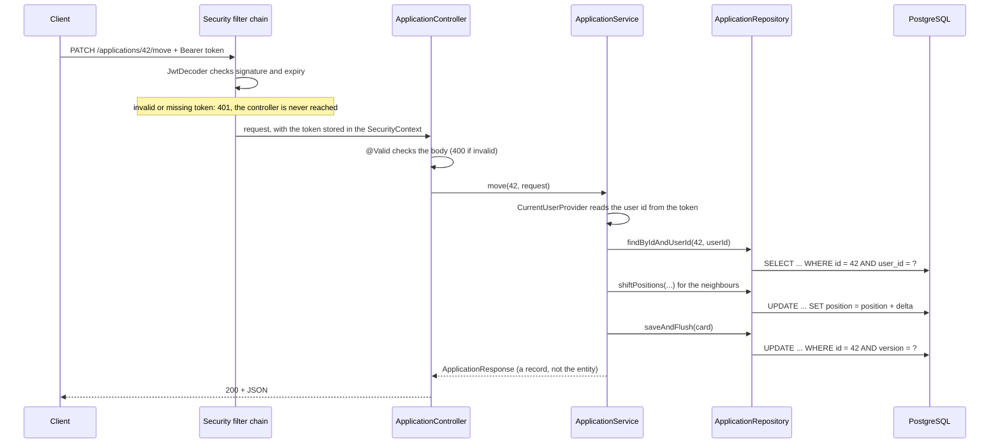
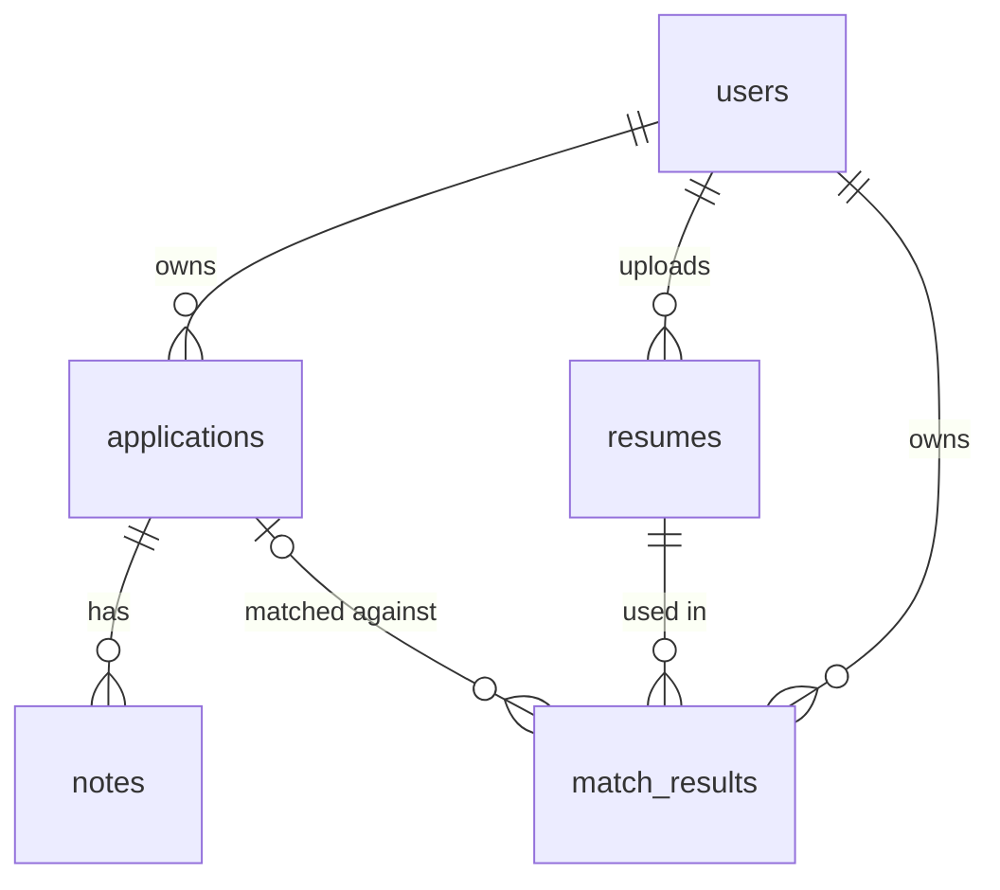

# Architecture

How the JobTrackr backend is organised and how its main logic works. Read this before changing code; read [DEBUGGING.md](DEBUGGING.md) when something is broken.

All paths below are relative to `jobtrackr-backend/`. The base Java package is `com.jobtrackr.jobtrackrbackend`.

## 1. Layout

```
jobtrackr-backend/
├── pom.xml                                   dependencies and build
└── src/
    ├── main/
    │   ├── java/com/jobtrackr/jobtrackrbackend/
    │   │   ├── JobtrackrBackendApplication   entry point; sets the JVM to UTC
    │   │   ├── application/                  job applications = Kanban cards (the core feature)
    │   │   ├── note/                         notes attached to an application
    │   │   ├── user/                         the account entity and GET /me
    │   │   ├── auth/                         register, login, JWT, security configuration
    │   │   └── common/                       shared pieces: current user, errors, paging, OpenAPI
    │   └── resources/
    │       ├── application.yml               all configuration
    │       └── db/migration/                 Flyway SQL migrations (the only place schema changes)
    └── test/
        ├── java/...                          mirrors the main packages
        └── resources/application-test.yml    test-only settings (dummy JWT secret)
```

The code is **packaged by feature, not by layer**. There is no global `controllers` or `services` package. To work on notes, everything you need is in `note/`.

## 2. What is inside a feature package

Every feature follows the same shape. Using `application/` as the example:

| Class | Role | Rule |
|---|---|---|
| `ApplicationController` | HTTP only: bind and validate the request, pick the status code | No business logic |
| `ApplicationService` | Business rules and the transaction boundary | The only layer that decides anything |
| `ApplicationRepository` | Database access (Spring Data JPA) | Queries only |
| `ApplicationSpecifications` | Reusable WHERE fragments for the filtered list | |
| `Application` | JPA entity, mapped to the `applications` table | Never leaves the service layer |
| `ApplicationMapper` | Entity to DTO and back, written by hand | The only place fields are copied |
| `dto/*` | Java records for request and response bodies | The API contract |
| `ApplicationStatus` | Enum of the four board columns | Must match the SQL CHECK constraint |

Dependencies between features:

- `note` uses `application` (a note needs its parent application to check ownership).
- `application` uses `note` (the detail view includes notes) and `user` (the owner reference).
- `auth` uses `user`.
- Everything may use `common`. `common` uses no feature.

## 3. Life of a request

`PATCH /api/v1/applications/42/move` with a Bearer token:



Any exception thrown in the controller or below is converted to JSON by `common/exception/GlobalExceptionHandler` (see section 9).

## 4. Data model

Defined in `db/migration/V1__init.sql`. Column-level explanations are stored in the database by `V3__schema_comments.sql`; in psql run `\d+ applications` to read them.



| Table | Java entity | Notes |
|---|---|---|
| `users` | `user/User` | `email` unique, stored lower-case. `password_hash` is BCrypt |
| `applications` | `application/Application` | One row per card. `(user_id, status, position)` is its place on the board. `version` is the optimistic-lock counter |
| `notes` | `note/Note` | No `user_id`; the owner is the owner of the parent application |
| `resumes` | none yet | Reserved for the AI match feature |
| `match_results` | none yet | Reserved for the AI match feature |

Deletion is handled by the database, not by JPA: deleting a user removes their applications, deleting an application removes its notes (`ON DELETE CASCADE`). That is why the entities have no `@OneToMany` collections and no JPA cascade settings.

`ddl-auto` is `validate`: at startup Hibernate compares every entity with the real tables and refuses to start on a mismatch. It never creates or alters anything.

## 5. Ownership: every query is scoped to the caller

This is the most important rule in the codebase.

- The caller's id comes from exactly one place: `common/CurrentUserProvider`, which reads the `sub` claim of the verified JWT. It is never taken from a URL, a query parameter or a request body.
- Single-record lookups use `findByIdAndUserId(id, userId)`. A record that belongs to someone else is indistinguishable from one that does not exist: both give 404.
- The list endpoint goes through `ApplicationSpecifications.filter(userId, status, searchText)`, which always includes the owner predicate.
- Notes are checked through their parent: `findByIdAndApplicationUserId`.

When adding a query, ask: "where is `user_id` in the WHERE clause?" If the answer is "nowhere", it is a bug.

## 6. Card ordering and the move algorithm

Within one user's column, positions are **zero-based and gap-free**: `0, 1, 2, ...`. Three operations maintain this, all in `ApplicationService`.

All of them use one repository method, `shiftPositions(userId, status, fromPosition, toPosition, delta)`, which runs a single `UPDATE ... SET position = position + delta` over a range of positions.

**Create** appends: `position = number of cards already in that column`.

**Delete** closes the gap: every card below the deleted one moves up by one.

**Move** (`PATCH /applications/{id}/move`, one `@Transactional` method):

Same column, moving down. Card B goes from 1 to 3:

```
before:  A0  B1  C2  D3  E4
step 1:  cards at positions 2..3 shift by -1      ->  A0  B1  C1  D2  E4   (B is about to move)
step 2:  B.position = 3                           ->  A0  C1  D2  B3  E4
```

Same column, moving up. Card D goes from 3 to 1: cards at positions 1..2 shift by +1, then `D.position = 1`.

Different column. Card B goes from APPLIED position 1 to INTERVIEW position 0:

```
APPLIED   before: A0 B1 C2      INTERVIEW before: X0 Y1
step 1: APPLIED cards below B shift by -1         ->  A0 C1
step 2: INTERVIEW cards at 0 and below shift +1   ->  X1 Y2
step 3: B.status = INTERVIEW, B.position = 0      ->  B0 X1 Y2
```

Details worth knowing:

- The requested position is **clamped**, not rejected: position 99 in a column of 3 becomes "last".
- Moving a card to the position it already has does nothing and returns early.
- If any step fails, the transaction rolls back and no position changes.
- The neighbour shift is a bulk JPQL update. It does not load the cards and **does not increment their `version`**, so dragging one card never makes the client's copies of the other cards stale. Only the moved card's version goes up.
- Known limitation: two simultaneous moves by the same user are not serialised and could, in theory, produce duplicate positions. [DEBUGGING.md](DEBUGGING.md) has a query to detect and repair this.

## 7. Optimistic locking on update

`Application.version` is a JPA `@Version` field.

1. The client reads a card and receives `version: 3`.
2. The client sends `PUT` with its changes and `version: 3`.
3. `ApplicationService.update` loads the card and compares. If the database now has `version: 4` (someone else saved first), it throws an optimistic-lock exception, which becomes **409**.
4. Otherwise the fields are copied, Hibernate runs `UPDATE ... WHERE id = ? AND version = 3` and sets the version to 4. The response carries the new version.

The comparison in step 3 is written explicitly because Hibernate's automatic check only compares against the row it loaded a moment ago, which is always current. The stale copy lives in the browser.

`PUT` replaces all editable fields: an optional field left out of the body is set to null. `status` and `position` cannot be changed by `PUT`; use the move endpoint.

## 8. Authentication

Stateless JWT, using Spring's OAuth2 resource server support. All of it is in `auth/`.

| Step | Where |
|---|---|
| Register: validate, lower-case the email, BCrypt the password, save, issue a token | `AuthService.register` |
| Login: find by email, check the password with BCrypt, issue a token. Unknown email and wrong password give the same 401 | `AuthService.login` |
| Build and sign the token (HS256, subject = user id, expires after `access-token-ttl`) | `TokenService` |
| Verify the token on every request; decide which paths are public | `SecurityConfig` |
| Read the user id back out of the verified token | `common/CurrentUserProvider` |

- The signing key comes from the `JWT_SECRET` environment variable through `JwtProperties`. HS256 is symmetric: the same key signs and verifies.
- Public paths: `/api/v1/auth/**` and the Swagger paths. Everything else, including `/actuator/**`, needs a token.
- There is no server-side session and no logout: a token is valid until it expires (15 minutes). Refresh tokens are not built yet.
- Restarting with a different `JWT_SECRET` invalidates every token issued before.

## 9. Errors

Every error body is an RFC 9457 `ProblemDetail` (`status`, `title`, `detail`, sometimes extra fields).

| Status | Cause | Raised by |
|---|---|---|
| 400 | Bean Validation failed; body has an `errors` map of field to message | `@Valid` on a controller parameter |
| 400 | Unreadable JSON, unknown enum value, wrong date format; no `errors` map | Spring MVC, before validation |
| 400 | `sort` names a field that is not whitelisted | `ApplicationService.list` |
| 401 | Wrong email or password | `AuthService.login` |
| 401 | Missing, expired or tampered token; **empty body**, reason in the `WWW-Authenticate` header | Security filter, before any controller |
| 404 | Record does not exist or belongs to another user | `NotFoundException` |
| 409 | Stale `version` on update | optimistic-lock exception |
| 409 | Email already registered | `ConflictException` |

To add a new error type: create an exception in `common/exception`, throw it from a service, add one `@ExceptionHandler` method to `GlobalExceptionHandler`.

## 10. Configuration

All in `src/main/resources/application.yml`.

| Setting | Value | Why |
|---|---|---|
| `spring.datasource.*` | `localhost:5432`, `jobtrackr` / `jobtrackr` | Must match `docker-compose.yml` |
| `spring.jpa.hibernate.ddl-auto` | `validate` | Flyway owns the schema |
| `spring.jpa.open-in-view` | `false` | All database access happens inside the service transaction |
| `spring.data.web.pageable.max-page-size` | `100` | Upper limit for `?size=` |
| `spring.docker.compose.enabled` | `false` | Docker is started by hand |
| `jobtrackr.jwt.secret` | `${JWT_SECRET}` | Required environment variable, at least 32 characters |
| `jobtrackr.jwt.access-token-ttl` | `15m` | Token lifetime |

The JVM default time zone is forced to UTC in `JobtrackrBackendApplication.main` (and in the surefire configuration for tests). All timestamps are `TIMESTAMPTZ` in the database and `Instant` in Java; converting to local time is the client's job.

## 11. Tests

| Kind | Examples | What they prove |
|---|---|---|
| Unit (Mockito, no Spring, no database) | `ApplicationServiceTest`, `NoteServiceTest`, `AuthServiceTest`, `UserServiceTest` | The service logic, especially the move arithmetic. Fast |
| Integration (`@SpringBootTest`, real PostgreSQL) | `ApplicationApiIntegrationTest`, `AuthApiIntegrationTest` | The real SQL, JSON shapes, status codes and the security filter chain |

Integration tests are `@Transactional` and roll back, and each one creates its own throwaway user, so they never touch existing data. `ApplicationApiIntegrationTest` replaces `CurrentUserProvider` with a mock and skips the security filters; `AuthApiIntegrationTest` uses real tokens through the real filters.

Every service method has a unit test. Keep it that way.
